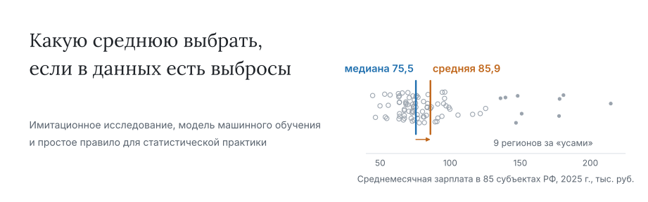
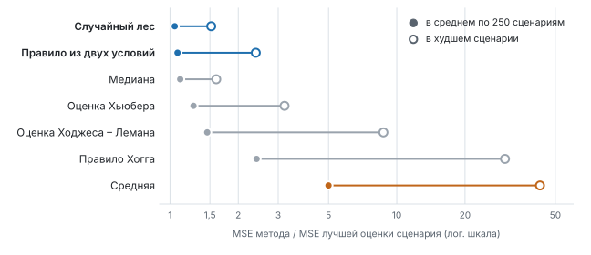

<picture>
  <source media="(prefers-color-scheme: dark)" srcset="docs/assets/banner-dark.svg">
  
</picture>

[](https://github.com/MarkNightingale/mean-estimator-choice/actions/workflows/ci.yml)
[](LICENSE)
[](requirements.txt)
[](CITATION.cff)
[](https://colab.research.google.com/github/MarkNightingale/mean-estimator-choice/blob/main/notebooks/demo.ipynb)

**[Русская версия](README.md)**. Figures and detailed documentation are in Russian.

A couple of stray values can drag the arithmetic mean far from where most observations sit, while the median, safe under contamination, is noticeably noisier on tidy data. This repository has everything needed to see which of five location estimators wins where, whether a classifier can make that call from the sample itself, and how its advice collapses into two thresholds you can check by hand. The evidence: 625 Monte Carlo scenarios with 5,000 samples each.

Code, data and results for a paper by E.Yu. Shimanskaya, M.V. Solovev and A.E. Skhvediani (Peter the Great St. Petersburg Polytechnic University). The paper is in preparation.

## The two-condition rule

> Huber estimator when both hold: share of points outside the boxplot whiskers **≤ 5%** and |x̄ − Me| / MAD **≤ 0.2**.
> Median in every other case.

MAD is the normalised one (× 1.483). These are the conservative thresholds, a sensible default for unfamiliar data. A looser pair, 16% and 0.3, does slightly better when there is no contamination but is easier to fool with outliers sitting close to the bulk on one side.

Try it in the [Colab notebook](https://colab.research.google.com/github/MarkNightingale/mean-estimator-choice/blob/main/notebooks/demo.ipynb) without installing anything, or locally:

```bash
pip install git+https://github.com/MarkNightingale/mean-estimator-choice
choose-estimator data/wages_2025.csv            # or: --variant soft
```

From Python: `from estimator_choice import choose_estimator; choose_estimator(values)`.

## Findings

<picture>
  <source media="(prefers-color-scheme: dark)" srcset="docs/assets/results-dark.svg">
  
</picture>

*250 scenarios (N(0, 1) and t(3)), cross-validation grouped by scenario. Horizontal axis: MSE divided by the oracle MSE, so 1 is as good as the best estimator for that scenario.*

| Question | Short answer |
|---|---|
| One estimator for all cases? | No. Under contamination the median leads, without it Huber does; the plain mean rarely wins. |
| Does the classifier help? | Yes, moderately: 5.4% excess MSE over the oracle vs 10.9% for the median; bootstrap interval of the gap 3.9–7.2 points. |
| How does Hogg's 1974 scheme fare? | It breaks under one-sided contamination: at ε = 0.2 its MSE is 8.6× the best. |
| Does the model travel to other tails? | Partly: on Laplace and t(2) the median is 5–8% better, on the logistic the model is ahead. |
| Rosstat data, 2025? | The median is chosen almost everywhere; the unweighted mean sits 7–41% above it. |

## Reproduce

```bash
pip install -r requirements.txt -r requirements-dev.txt
make quick   # tables and figures from saved results, seconds
make test    # unit tests
make smoke   # the whole pipeline in reduced form, about 2 minutes
make all     # full run from scratch, about 35 minutes
```

All random seeds are fixed. Large intermediate files (`store.pkl`, `rf_*.pkl`, ~370 MB) are not stored; `experiments/simulate.py` and `experiments/train_models.py` recreate them. See [docs/methodology.md](docs/methodology.md) for the design and [docs/results.md](docs/results.md) for all tables.

## Citation

Use **Cite this repository** on the right (from [CITATION.cff](CITATION.cff)). The paper reference will be added after publication.

## Authors

- **Elizaveta Yu. Shimanskaya** — Master’s Student
- **Mark V. Solovev** — Assistant, Graduate School of Industrial Economics ([ORCID 0000-0003-4626-6595](https://orcid.org/0000-0003-4626-6595))
- **Angi E. Skhvediani** — Cand. Sci. (Econ.), Associate Professor, Graduate School of Industrial Economics ([ORCID 0000-0001-7171-7357](https://orcid.org/0000-0001-7171-7357))

Peter the Great St. Petersburg Polytechnic University, 29 Politekhnicheskaya St., St. Petersburg, 195251, Russia. Questions about the code: [Issues](https://github.com/MarkNightingale/mean-estimator-choice/issues).

## License

Code: [MIT](LICENSE). Data: open data of Rosstat (Federal State Statistics Service of Russia); please cite the original source.
