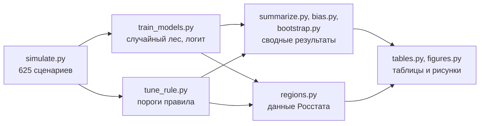

<picture>
  <source media="(prefers-color-scheme: dark)" srcset="docs/assets/banner-dark.svg">
  
</picture>

[](https://github.com/MarkNightingale/mean-estimator-choice/actions/workflows/ci.yml)
[](LICENSE)
[](requirements.txt)
[](CITATION.cff)
[](https://colab.research.google.com/github/MarkNightingale/mean-estimator-choice/blob/main/notebooks/demo.ipynb)

**[English version](README.en.md)**

Пара аномальных значений легко уводит среднее арифметическое в сторону, а медиана, надёжная при засорении, на аккуратных данных заметно шумнее. Здесь лежит всё, чтобы проверить, какая из пяти оценок центра лучше в какой ситуации, может ли классификатор подсказывать выбор по самой выборке и как упростить его подсказки до двух порогов, которые считаются на калькуляторе. Основа — 625 сценариев Монте-Карло по 5 000 выборок.

Код, данные и результаты к статье М.В. Соловьева, Е.Ю. Шиманской и А.Е. Схведиани (СПбПУ Петра Великого). Статья готовится к публикации.

## Правило из двух условий

> Оценка Хьюбера — если одновременно: точек за «усами» боксплота **≤ 5 %** и |x̄ − Me| / MAD **≤ 0,2**.
> Во всех остальных случаях — медиана.

MAD берётся в нормированном виде (× 1,483). Пороги выше — консервативные, с ними стоит начинать, если про данные ничего не известно. Есть и более мягкая пара порогов, 16 % и 0,3: она чуть выигрывает, когда засорения нет, но хуже ловит выбросы, сидящие недалеко от основной массы и с одной стороны.

Проверить свои данные — проще всего в [ноутбуке в Colab](https://colab.research.google.com/github/MarkNightingale/mean-estimator-choice/blob/main/notebooks/demo.ipynb), ничего не устанавливая. Или локально:

```bash
pip install git+https://github.com/MarkNightingale/mean-estimator-choice
choose-estimator data/wages_2025.csv      # CSV: берётся последний числовой столбец
```
```text
Наблюдений: 85
Доля за «усами»: 10.6%; |средняя − медиана| / MAD: 0.68
Средняя 85 887; медиана 75 525; оценка Хьюбера 78 840
Правило (cautious): медиана = 75 525
```

Из Python:

```python
from estimator_choice import choose_estimator

r = choose_estimator(values)          # осторожный вариант; variant="soft" — мягкий
r["estimator"], r["value"]            # ('median', 75525.0)
```

Функция возвращает выбранную оценку, её значение, обе характеристики выборки и для сравнения среднюю, медиану и оценку Хьюбера. Сами оценки, статистика Хогга и характеристики выборки — в модуле `estimator_choice.estimators`.

## Что получилось

<picture>
  <source media="(prefers-color-scheme: dark)" srcset="docs/assets/results-dark.svg">
  
</picture>

*250 сценариев (N(0, 1) и t(3)), перекрёстная проверка с группировкой по сценарию. По горизонтали — MSE, делённая на MSE «оракула»: 1 означает точность лучшей оценки этого сценария.*

| Вопрос | Короткий ответ |
|---|---|
| Есть ли одна оценка «на все случаи»? | Нет. При засорении впереди медиана, без него — Хьюбер; среднее арифметическое лидирует редко. |
| Помогает ли классификатор? | Да, но умеренно: избыток MSE над «оракулом» 5,4 % против 10,9 % у медианы; бутстреп-интервал разницы 3,9–7,2 п. п. |
| Как работает схема Хогга (1974)? | Ломается на засорении с одной стороны: при ε = 0,2 её MSE в 8,6 раза выше лучшей. |
| Переносится ли модель на другие хвосты? | Частично: на Лапласе и t(2) медиана лучше на 5–8 %, на логистическом модель впереди. |
| Что с данными Росстата за 2025 г.? | Почти везде выбор — медиана; невзвешенное среднее выше неё на 7–41 %. Два «лишних нуля» двигают среднее на 21–22 %, медиану — меньше 5 %. |

Числа подробнее — в [docs/results.md](docs/results.md), устройство эксперимента — в [docs/methodology.md](docs/methodology.md).

## Как воспроизвести

```bash
git clone https://github.com/MarkNightingale/mean-estimator-choice
cd mean-estimator-choice
pip install -r requirements.txt -r requirements-dev.txt

make quick   # таблицы и рисунки по сохранённым результатам — секунды
make test    # автотесты
make smoke   # весь конвейер в сокращённом виде во временной папке — около 2 минут
make all     # полный расчёт с нуля — около 35 минут
```

Генераторы случайных чисел зафиксированы, поэтому полный расчёт даёт те же числа; это проверено повторным прогоном. `make check` пересчитывает таблицы и сверяет их с сохранёнными, `make help` показывает все команды. Без `make` шаги запускаются как `python experiments/<скрипт>.py` из корня репозитория. При каждом изменении на GitHub автоматически запускаются тесты, `make check` и `make smoke`.



Большие промежуточные файлы (`store.pkl`, `rf_*.pkl`, вместе около 370 МБ) в репозиторий не включены; их создают `simulate.py` и `train_models.py`.

## Что где лежит

```text
estimator_choice/   устанавливаемый пакет: правило (rule.py), оценки и характеристики выборки (estimators.py)
experiments/        шаги эксперимента: simulate → train_models → tune_rule → summarize, bias, bootstrap → regions → tables, figures
data/               пять показателей Росстата по субъектам РФ за 2025 г., источники и контрольные суммы
results/            результаты по сценариям и методам, бутстреп-интервалы, таблицы статьи (tables.json)
figures/            рисунки статьи (300 dpi, оттенки серого) и их данные в Excel
notebooks/          демонстрация на данных о зарплате, открывается в Colab
docs/               методика, все таблицы, иллюстрации README
tests/              автотесты оценок, характеристик выборки и правила
```

## Данные

Среднемесячная зарплата, среднедушевые денежные доходы, уровень безработицы, стоимость минимального набора продуктов и цены на вторичном рынке жилья по субъектам РФ за 2025 г. — официальные данные Росстата, полученные через сервис StatBase. Источники и контрольные суммы — в [data/README.md](data/README.md).

## Как цитировать

GitHub предлагает готовую ссылку в меню **Cite this repository** справа (по файлу [CITATION.cff](CITATION.cff)). Ссылка на статью появится здесь после публикации.

```bibtex
@software{solovev_mean_estimator_choice_2026,
  author  = {Соловьев, Марк Владиславович and Шиманская, Елизавета Юрьевна and Схведиани, Анги Ерастиевич},
  title   = {Выбор оценки среднего уровня при выбросах с помощью машинного обучения: код, данные и результаты},
  year    = {2026},
  version = {1.1.0},
  url     = {https://github.com/MarkNightingale/mean-estimator-choice}
}
```

## Авторы

- **Соловьев Марк Владиславович** — ассистент Высшей инженерно-экономической школы ИПМЭиТ ([ORCID 0000-0003-4626-6595](https://orcid.org/0000-0003-4626-6595))
- **Шиманская Елизавета Юрьевна** — студент-магистр
- **Схведиани Анги Ерастиевич** — канд. экон. наук, доцент Высшей инженерно-экономической школы ИПМЭиТ ([ORCID 0000-0001-7171-7357](https://orcid.org/0000-0001-7171-7357))

Санкт-Петербургский политехнический университет Петра Великого, 195251, г. Санкт-Петербург, ул. Политехническая, д. 29. Вопросы и замечания по коду — через [Issues](https://github.com/MarkNightingale/mean-estimator-choice/issues).

## Лицензия

Код — [MIT](LICENSE). Данные — открытые данные Росстата; при использовании ссылайтесь на первоисточник.
