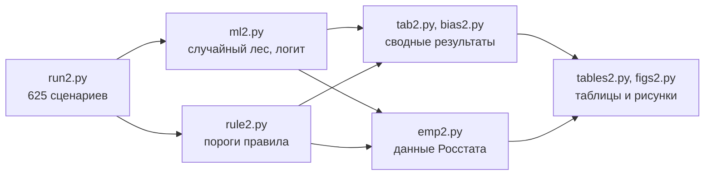

<picture>
  <source media="(prefers-color-scheme: dark)" srcset="docs/assets/banner-dark.svg">
  
</picture>

[](https://github.com/MarkNightingale/mean-estimator-choice/actions/workflows/ci.yml)
[](LICENSE)
[](requirements.txt)
[](CITATION.cff)

**[English version](README.en.md)**

Средняя арифметическая плохо описывает типичный уровень показателя, когда в данных есть выбросы, а медиана теряет точность на «чистых» данных. Мы проверили на 625 сценариях Монте-Карло, может ли модель машинного обучения выбирать оценку по характеристикам конкретной выборки, и свели её работу к правилу, которое применяется без программирования.

Код, данные и результаты к статье Е.Ю. Шиманской, М.В. Соловьева и А.Е. Схведиани (СПбПУ Петра Великого). Статья готовится к публикации.

## Правило из двух условий

> Если за «усами» диаграммы размаха **не больше 5 %** наблюдений, а средняя отличается от медианы **не больше чем на 0,20 MAD** — используйте оценку Хьюбера. Иначе — медиану.

MAD здесь умножено на 1,483. Это осторожный вариант правила, его мы рекомендуем для данных, о которых заранее ничего не известно. Мягкий вариант (16 % и 0,30 MAD) точнее на «чистых» данных, но может пропустить близкие односторонние выбросы.

Проверить свои данные:

```bash
python src/choose.py data/wages_2025.csv
```
```text
Наблюдений: 85
Доля за «усами»: 10.6%; |средняя − медиана| / MAD: 0.68
Средняя 85 887; медиана 75 525; оценка Хьюбера 78 840
Правило (cautious): медиана = 75 525
```

Или из Python: `from choose import choose_estimator; choose_estimator(values)` — функция вернёт выбранную оценку, её значение и характеристики выборки.

## Что получилось

<picture>
  <source media="(prefers-color-scheme: dark)" srcset="docs/assets/results-dark.svg">
  
</picture>

*Нормальное распределение и распределение Стьюдента, 250 сценариев, перекрёстная проверка по сценариям. Значение 1 — точность лучшей для сценария оценки.*

- **Универсально лучшей оценки нет.** Медиана выигрывает при выбросах, оценка Хьюбера — без них, средняя — почти никогда.
- **Модель точнее любой фиксированной оценки** и в среднем, и в худшем сценарии, но выигрыш скромный: в среднем модель проигрывает лучшей оценке 5 % по MSE, медиана — 11 %.
- **Правило Хогга (1974) не справляется с односторонними выбросами**: при 20 % таких выбросов его ошибка в 8,6 раза больше минимальной.
- **Переносимость неполная.** На распределениях Лапласа и Стьюдента с 2 ст. св. модель уступает медиане на 5–8 %, на логистическом — точнее её.
- **Региональные данные.** Для пяти показателей Росстата за 2025 г. почти все процедуры выбирают медиану; невзвешенная средняя выше неё на 7–41 %. Ошибка с лишним разрядом в двух регионах сдвигает среднюю на 21–22 %, медиану — меньше чем на 5 %.

Все таблицы статьи — в [docs/results.md](docs/results.md), подробная методика — в [docs/methodology.md](docs/methodology.md).

## Как воспроизвести

```bash
git clone https://github.com/MarkNightingale/mean-estimator-choice
cd mean-estimator-choice
pip install -r requirements.txt -r requirements-dev.txt

make quick   # таблицы и рисунки по сохранённым результатам — секунды
make test    # автотесты
make all     # полный расчёт с нуля — около часа
```

Генераторы случайных чисел зафиксированы, поэтому полный расчёт даёт те же числа. Команда `make check` пересчитывает таблицы и сверяет их с сохранёнными. Без `make` те же шаги запускаются как `python src/<скрипт>.py` из корня репозитория.



Большие промежуточные файлы (`store2.pkl`, `rf_*.pkl`, вместе около 370 МБ) в репозиторий не включены; их создают `run2.py` и `ml2.py`.

## Что где лежит

```text
src/            расчёт: оценки и генерация выборок (sim.py, sim2.py), шаги эксперимента, choose.py — правило
data/           пять показателей Росстата по субъектам РФ за 2025 г., источники и контрольные суммы
results/        результаты по сценариям и методам, таблицы статьи (tables2.json)
figures/        рисунки статьи (300 dpi, оттенки серого) и их данные в Excel
docs/           методика, все таблицы, иллюстрации README
tests/          автотесты оценок, характеристик выборки и правила
```

## Данные

Среднемесячная зарплата, среднедушевые денежные доходы, уровень безработицы, стоимость минимального набора продуктов и цены на вторичном рынке жилья по субъектам РФ за 2025 г. — официальные данные Росстата, полученные через сервис StatBase. Источники и контрольные суммы — в [data/README.md](data/README.md).

## Как цитировать

GitHub предлагает готовую ссылку в меню **Cite this repository** справа (по файлу [CITATION.cff](CITATION.cff)). Ссылка на статью появится здесь после публикации.

```bibtex
@software{shimanskaya_mean_estimator_choice_2026,
  author  = {Шиманская, Елизавета Юрьевна and Соловьев, Марк Владиславович and Схведиани, Анги Ерастиевич},
  title   = {Выбор оценки среднего уровня при выбросах с помощью машинного обучения: код, данные и результаты},
  year    = {2026},
  version = {1.0.0},
  url     = {https://github.com/MarkNightingale/mean-estimator-choice}
}
```

## Авторы

- Шиманская Елизавета Юрьевна
- Соловьев Марк Владиславович
- Схведиани Анги Ерастиевич ([ORCID](https://orcid.org/0000-0001-7171-7357))

Санкт-Петербургский политехнический университет Петра Великого.

## Лицензия

Код — [MIT](LICENSE). Данные — открытые данные Росстата; при использовании ссылайтесь на первоисточник.
